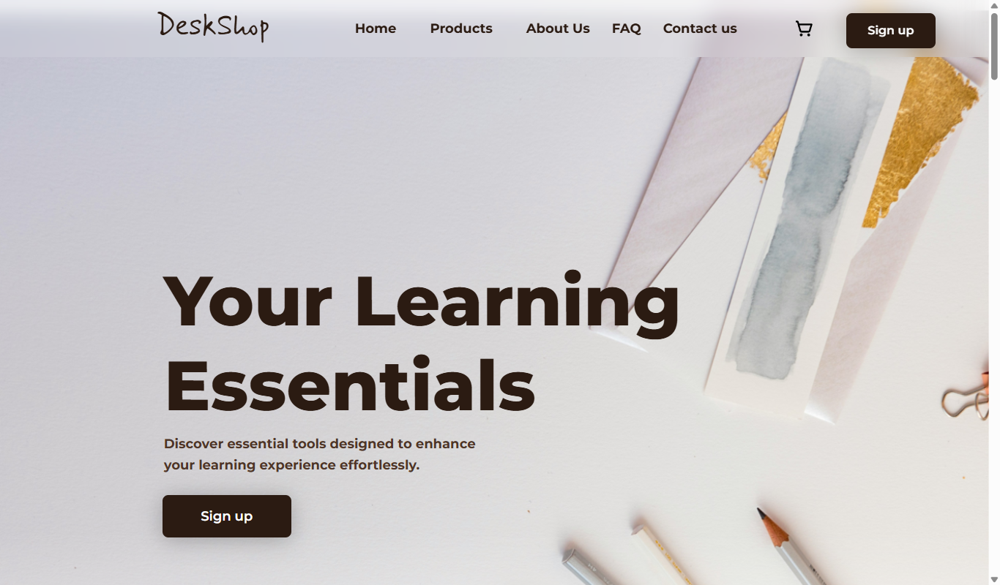
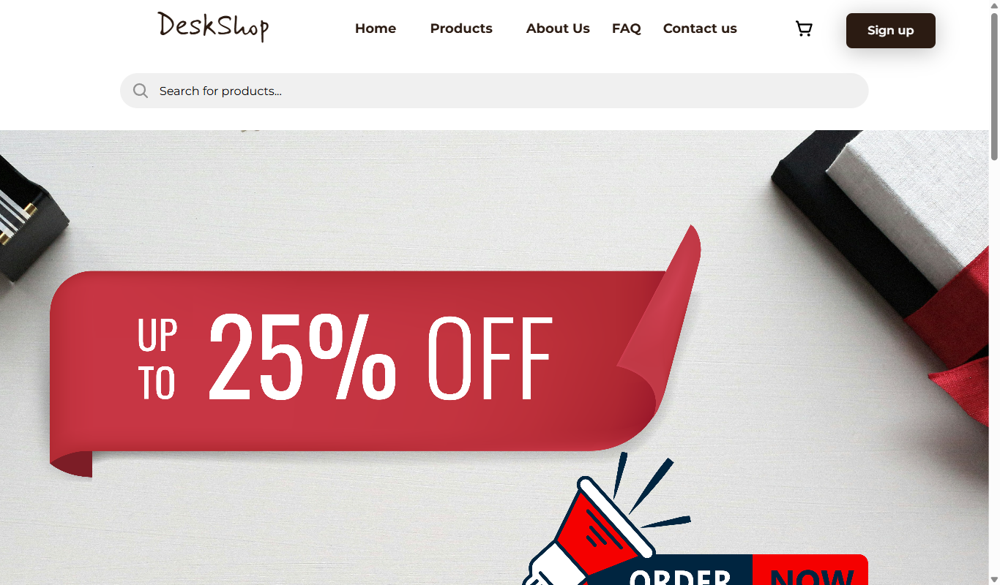
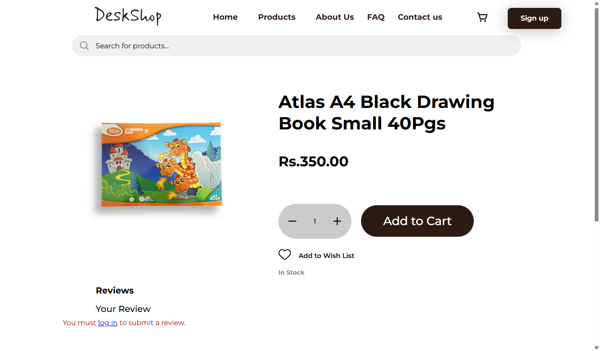
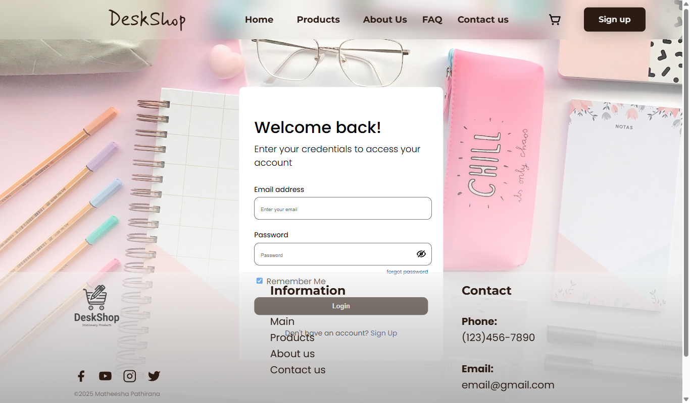
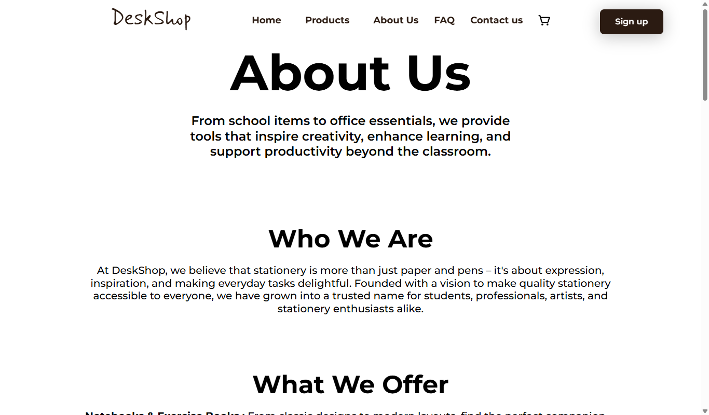

# DeskShop

DeskShop is an online stationery and office-supplies store built with plain **PHP**, **MySQL**, HTML and CSS for a Web Application Development (WAD) assignment (Year 1, Semester 2). Customers can browse products, manage a cart and wishlist, and track orders. Admins get a dashboard for products, users, orders, reviews and customer inquiries.

## Screenshots

| Home | Shop |
|------|------|
|  |  |

| Product page | Sign in |
|--------------|---------|
|  |  |

| About us |
|----------|
|  |

## Features

**Customers**
- Sign up, sign in, password reset and profile management
- Browse the catalogue by category and view product details and reviews
- Shopping cart and wishlist
- Order tracking
- Contact form and newsletter subscription

**Admin**
- Add, edit and delete products
- Manage users
- View orders, product reviews and contact inquiries
- Dark-mode admin pages

## Tech stack

- PHP (mysqli) with sessions and cookies
- MySQL / MariaDB
- HTML5 and CSS3
- Runs on XAMPP locally; deployable to shared hosting such as InfinityFree

## Project structure

```
.
├── index.php, shop.php, product.php, cart.php, ...   # Public pages (each has its own .css)
├── Admin/            # Admin dashboard and management pages
├── PHP/              # Form handlers (login, registration, password reset, logout, cart)
├── HTML/             # Static HTML versions of the pages
├── Assets/           # Images, icons and banners
├── database/         # SQL schema and seed data
├── config.sample.php # Database config template
└── db.php            # Central db_connect() helper
```

## Getting started (XAMPP)

1. Install [XAMPP](https://www.apachefriends.org/) and start **Apache** and **MySQL**.
2. Clone the repo into `htdocs`:
   ```bash
   cd C:/xampp/htdocs
   git clone https://github.com/matheeshapathirana/Deskshop.git DeskShop-WAD-Assignment
   ```
3. Create the database and load the data in phpMyAdmin (or the MySQL CLI), in this order:
   - `database/deskshop.sql` (schema)
   - `database/seed.sql` (sample products, categories and users)
4. Copy the config template and edit it if your credentials differ:
   ```bash
   cp config.sample.php config.php
   ```
   The defaults match XAMPP (`root`, no password, database `deskshop`). `config.php` is git-ignored.
5. Open <http://localhost/DeskShop-WAD-Assignment/index.php>.

### Sample accounts

| Role     | Email                   | Password      |
|----------|-------------------------|---------------|
| Admin    | demo.admin@example.com    | DemoAdmin#2026 |
| Customer | demo.customer@example.com | DemoCust#2026  |

> These are demo credentials for local development only. Change them before any public deployment.

## Deploying to shared hosting

Use `database/deskshop_infinityfree.sql` and `database/seed_infinityfree.sql`. They contain no `CREATE DATABASE` or `USE` statements, so select your database in phpMyAdmin first, then import. Fill the non-local branch of `config.php` with your host's MySQL details and upload the files over FTP.

## Known limitations

- Passwords are stored in plain text and authentication relies on cookies. This is acceptable for a coursework demo, but should move to `password_hash()` and server-side sessions before real use.

## Author

Matheesha Pathirana — [GitHub](https://github.com/matheeshapathirana)
